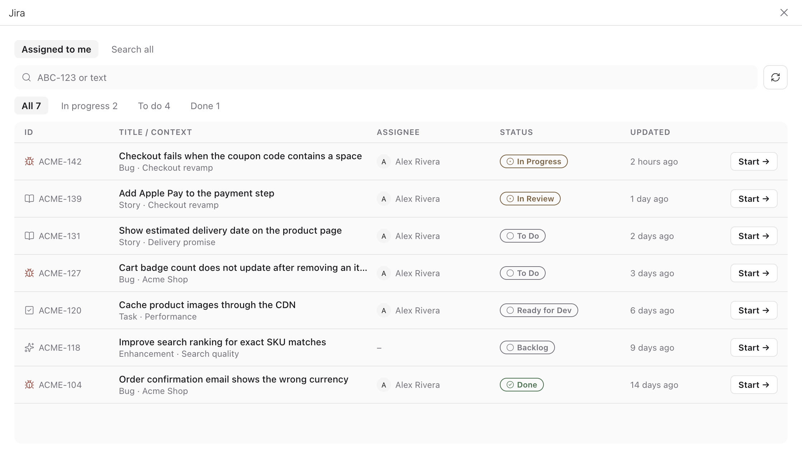

# paseo-jira


A [Paseo](https://paseo.sh) plugin that lists your Jira Cloud tickets and creates a worktree workspace from any of them, with the branch, worktree name and title suggested from the ticket.



## Features

- **Jira screen** in the sidebar: a table of tickets with key, title, context (parent epic or project), assignee, status and last update.
- **Two scopes**: *Assigned to me* and *Search all*. Type a key such as `ABC-123` to jump to that ticket, or any text for a full-text search.
- **Status filter chips** with counts (In progress, To do, Done), grouped by Jira status category, so custom workflow names still get the right colour.
- **Start →** on every row creates a workspace in one click using the suggested names and opens an empty agent chat in it.
- **Ticket detail**: open a ticket to review its metadata, edit the branch, worktree name, title, base ref and project, and turn off *Start agent* to only create the workspace.
- **Command Center**: `Jira: worktree from ticket` opens the screen from ⌘K.

## Requirements

- Paseo `>=0.12.0-beta.1` with plugins enabled (Settings → Plugins → Enable plugins).
- A Jira Cloud site and an [Atlassian API token](https://id.atlassian.com/manage-profile/security/api-tokens).
- The target project registered in Paseo as a git project.

## Install

```bash
git clone https://github.com/tranhuywin/paseo-jira.git
cd paseo-jira
npm install
paseo plugin install "$PWD"
paseo plugin ls   # paseo-jira should be running
```

## Setup

Open Settings → Plugins → Jira, fill in the fields below, press **Save**, then **Test**.

| Setting | Default | Purpose |
| --- | --- | --- |
| Site URL | empty | `https://your-site.atlassian.net` |
| Email | empty | Atlassian account email |
| API token | empty | Atlassian API token |
| My issues JQL | `assignee = currentUser() AND statusCategory != Done` | Query for *Assigned to me* |
| Search scope JQL | `updated >= -90d` | Query for *Search all*. Jira requires a bounded query, for example `project in (ABC)` |
| Default project path | empty | Root path of the Paseo project to branch from. Empty picks the first git project |
| Bug branch prefix | `fix` | Prefix for tickets of type Bug |
| Other branch prefix | `feature` | Prefix for every other type |
| Base ref | `main` | Ref the new branch starts from |
| Naming prompt | empty | Empty uses the prefixes. Otherwise the naming model gets this prompt with the ticket key, type and summary and returns the branch, worktree and title |
| Naming model | `claude/claude-haiku-5-5` | `provider/model` used for the naming prompt |
| Agent provider | `claude/claude-opus-5-5` | `provider/model` used when *Start agent* is on |
| Agent prompt | `Work on Jira ticket {key}.` | First prompt; `{key}` becomes the ticket key |

## Naming

For `ABC-123` "Login fails when the password contains a quote" of type Bug:

| Field | Suggestion |
| --- | --- |
| Branch | `fix/ABC-123-login-fails-password-contains-quote` |
| Worktree | `abc-123-login-fails-password-contains-quote` |
| Title | `ABC-123 Login fails when the password contains a quote` |

The slug drops bracketed tags such as `[BE]`, strips accents, removes common stop words and keeps the first five words. Every field stays editable in the ticket detail.

With a *Naming prompt* set, a short-lived agent on the naming model writes the three names instead, from your prompt and the ticket key, type and summary. It runs once per ticket in the project root, takes a few seconds, and is archived as soon as it answers. If it fails, the ticket detail falls back to the prefix rules and **Start →** on a row shows the error.

## Security and data

- The API token is stored as plain JSON in the plugin settings under the daemon's Paseo home (`~/.paseo`). Anyone with access to that machine account can read it.
- Jira requests run in the daemon process and go only to the configured Jira site, through the Jira Cloud REST API v3.
- **Start** opens an agent chat without sending anything; nothing reaches the agent provider until you send a message.
- With a *Naming prompt* set, the prompt and the ticket key, type and summary go to the naming model when you open a ticket or press **Start →**.

## Limits

- Jira Cloud only; Jira Server and Data Center use a different search API.
- Each query returns the 50 most recently updated tickets.

## Development

```bash
npm install
npm run typecheck
paseo plugin reload paseo-jira
paseo plugin logs paseo-jira
```

| Path | Runtime |
| --- | --- |
| `index.client.tsx`, `client/` | Paseo app: screen, settings, ticket detail |
| `index.server.ts`, `server/` | Daemon subprocess: Jira REST calls |
| `shared/` | Both: RPC contracts, settings schema, naming rules |
